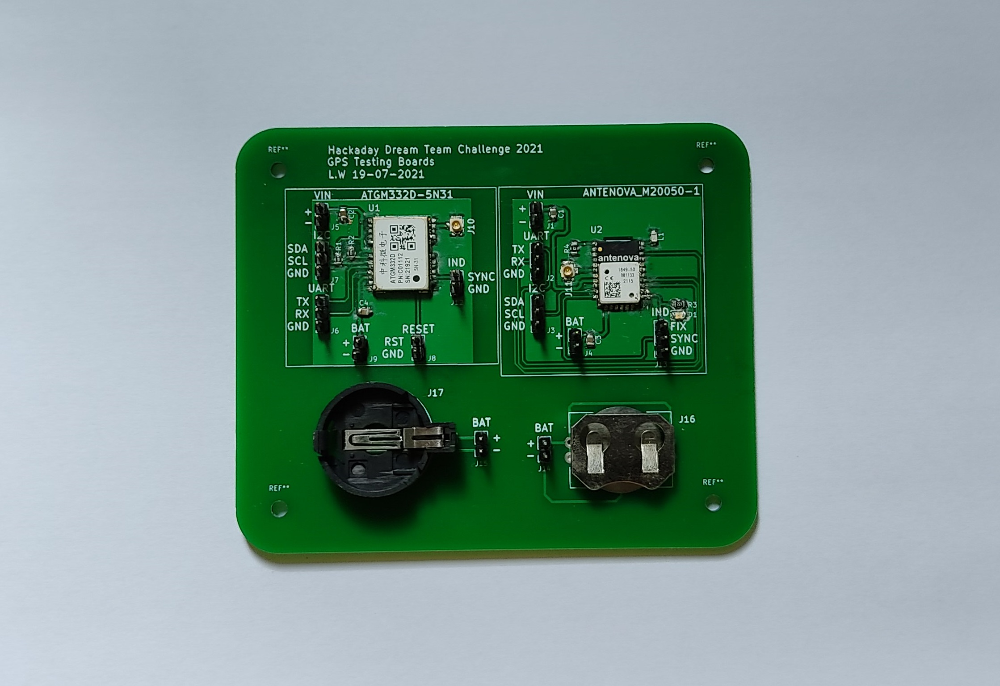
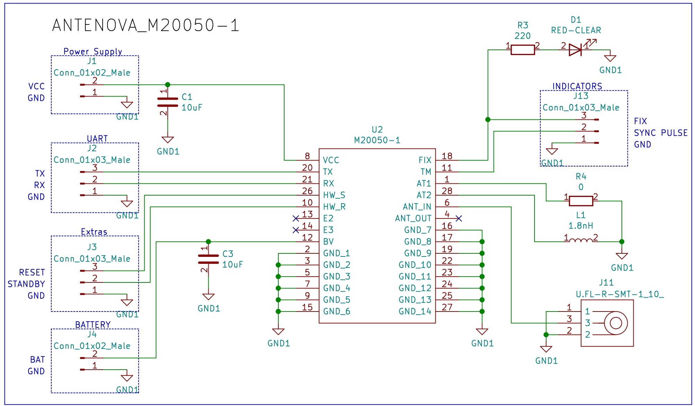
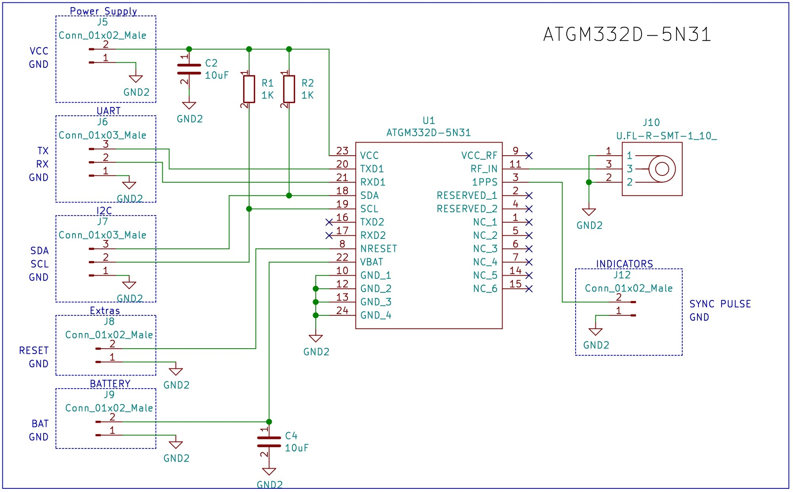
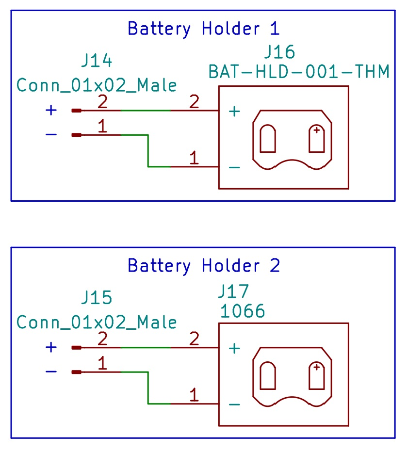
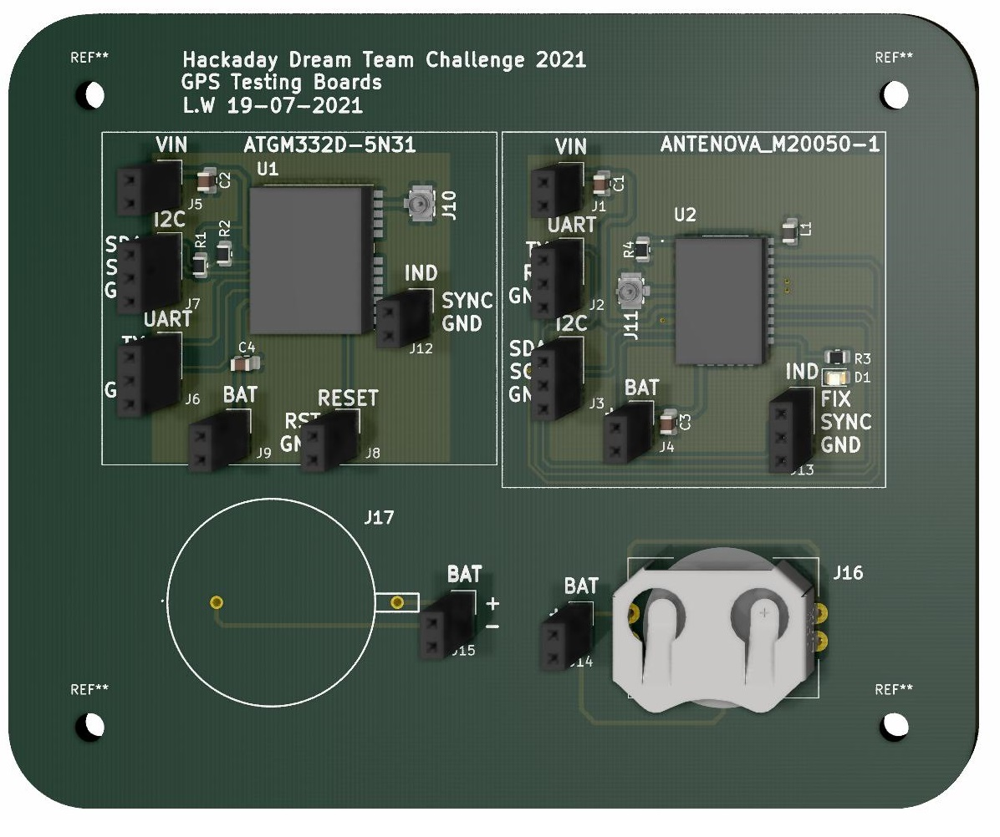
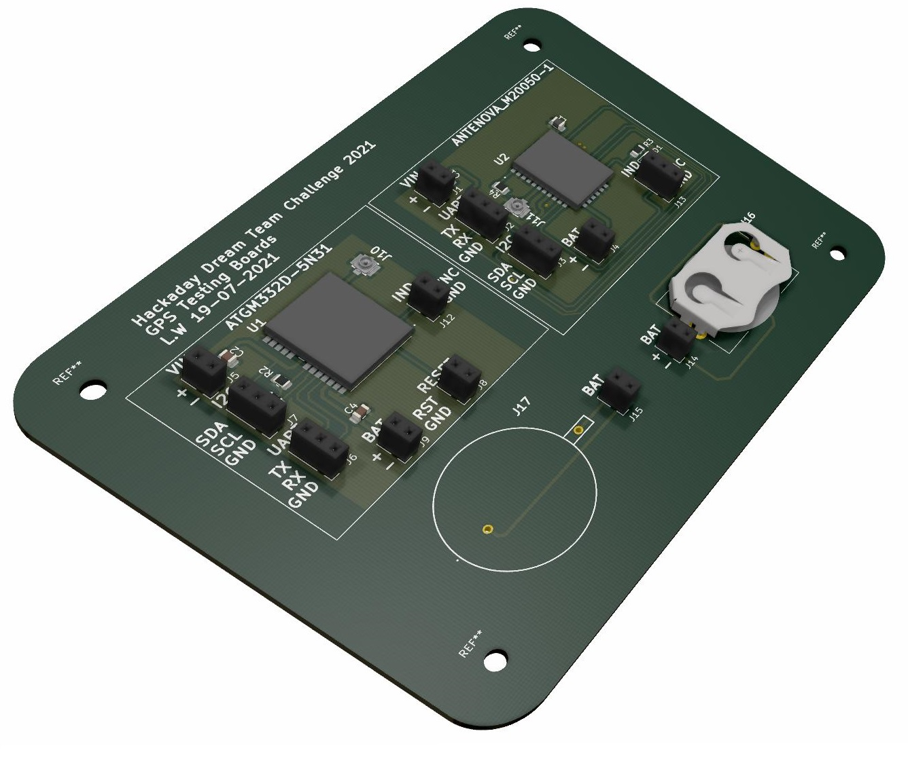

# GPS Development Board - ANTENOVA M20050-1 and ATGM332D-5N31 #

<p align="center">
  
</p>

A KiCad breakout board for evaluating two GPS modules side by side &mdash; the
[ANTENOVA M20050-1](https://www.digikey.com/en/products/detail/antenova/M20050-1/7931495)
and the
[ATGM332D-5N31](https://lcsc.com/product-detail/Satellite-Positioning-Modules_ZHONGKEWEI-ATGM332D-5N31_C128659.html)
&mdash; plus two footprints for 20&nbsp;mm coin&#8209;cell holders to keep the module's
backup RAM / almanac powered for a warm start.

## Context

This is one of the breakout boards made for the
**[EJA "Intelligent Popup Buoy"](https://hackaday.io/project/173457-2021-hdp-dream-team-eja)**
project (2021 Hackaday Dream Team). Each candidate part for the
[EJA&nbsp;M](https://github.com/leonardoward/eja-m-pcb-design) board was first tried on a
small dedicated PCB. Both GPS modules speak plain **NMEA over UART** and are wired to
identical header pinouts here, so the same ESP32 firmware runs against either one.
The **ATGM332D-5N31** was the module chosen for EJA&nbsp;M.

## Table of Contents

1. [Schematic](#schematic)
2. [Bill of Materials](#bill-of-materials)
3. [3D Model](#3d-model)
4. [Firmware and Testing](#firmware-and-testing)
5. [Repository Layout](#repository-layout)

## Schematic ##

### ANTENOVA M20050-1 ###

<p align="center">
  
</p>

### ATGM332D-5N31 ###

<p align="center">
  
</p>

Each module has a decoupling capacitor, a U.FL connector for an external active
antenna, a coin&#8209;cell backup input, and UART / I2C / `IND` (fix indicator) broken
out to headers.

### Additional Coin Battery Holders ###

<p align="center">
  
</p>

Two 20&nbsp;mm coin&#8209;cell holder footprints (a
[Linx BAT-HLD-001](https://www.digikey.com/en/products/detail/linx-technologies-inc/BAT-HLD-001-THM/3044009)
retainer and a
[Keystone 1066](https://www.digikey.com/en/products/detail/keystone-electronics/1066/303562)
open holder) so the mechanically better one can be picked for the buoy.

## Bill of Materials ##

| Reference | Quantity |
| ------------- | ------------- |
| [10 µF ±10% 6.3V Ceramic Capacitor X5R 0805 (2012 Metric)](https://www.digikey.com/en/products/detail/samsung-electro-mechanics/CL21A106KQCLNNC/3888062)  | 4 |
| [Red 630nm LED Indication - Discrete 1.9V 0805 (2012 Metric)](https://www.digikey.com/en/products/detail/w%C3%BCrth-elektronik/150080SS75000/4489921)  | 1 |
| [U.FL (UMCC) Connector Receptacle, Male Pin 50Ohm Surface Mount Solder](https://www.digikey.com/en/products/detail/hirose-electric-co-ltd/U-FL-R-SMT-1-10/2391570) | 2 |
| [Battery Retainer Coin, 20.0mm 1 Cell PC Pin](https://www.digikey.com/en/products/detail/linx-technologies-inc/BAT-HLD-001-THM/3044009) | 1 |
| [Battery Holder (Open) Coin, 20.0mm 1 Cell PC Pin](https://www.digikey.com/en/products/detail/keystone-electronics/1066/303562) | 1 |
| [Unshielded Multilayer Inductor 100mOhm Max 0805 (2012 Metric)](https://www.digikey.com/en/products/detail/abracon-llc/AIMC-0805-1N8S-T/2662915) | 1 |
| [1K ±1% 0.125W, 1/8W Chip Resistor 0805 (2012 Metric)](https://www.digikey.com/en/products/detail/panasonic-electronic-components/ERJ-6ENF1001V/111281) | 2 |
| [220 Ohms ±5% 0.125W, 1/8W Chip Resistor 0805 (2012 Metric)](https://www.digikey.com/en/products/detail/yageo/RC0805JR-07220RL/728283) | 1 |
| [0 Ohms Jumper 0.125W, 1/8W Chip Resistor 0805 (2012 Metric)](https://www.digikey.com/en/products/detail/yageo/RC0805JR-070RL/728216) | 1 |
| [ATGM332D-5N31 GNSS GPS+BDS Satellite Positioning Module](https://lcsc.com/product-detail/Satellite-Positioning-Modules_ZHONGKEWEI-ATGM332D-5N31_C128659.html) | 1 |
| [Antenova M20050-1 RF Receiver GPS 1.575GHz -165dBm](https://www.digikey.com/en/products/detail/antenova/M20050-1/7931495) | 1 |
| [Conn Header 40POS 2.54](https://www.digikey.com/en/products/detail/3m/2340-6111TG/1237275) | 1 |

A machine-readable BOM is in `gps-testing-board/gps-testing-board.csv`.

## 3D Model ##

<p align="center">
  
</p>

<p align="center">
  
</p>

## Firmware and Testing ##

`Firmware/` has an Arduino sketch for each module (`esp32_atgm332d/` and
`esp32_antenova_m20050/`). Both are the same code with a different banner; only one
module is exercised at a time.

* The ESP32's `Serial2` runs at **9600 baud** on **GPIO16 (RX) / GPIO17 (TX)**, wired
  to the module's UART header.
* The [`FuGPS`](https://github.com/fu-hsi/FuGPS) library parses the NMEA stream. The
  sketch asks the module for `RMC + GGA` sentences
  (`FUGPS_PMTK_API_SET_NMEA_OUTPUT_RMCGGA`).
* When a fix is available it prints fix quality, satellite count, HDOP, altitude and a
  ready&#8209;to&#8209;click `google.com/maps` link with the current latitude / longitude;
  if the module goes quiet for ~10&nbsp;s it prints a "not responding" warning.

<p align="center">
  
</p>

Wire the module header to the ESP32 (`VIN`&rarr;`3V3`, `GND`&rarr;`GND`,
`TX`&rarr;`GPIO16`, `RX`&rarr;`GPIO17`), fit an active antenna on the U.FL connector,
open the matching sketch in the Arduino IDE (ESP32 board support + the `FuGPS` library
installed) and watch the serial monitor at 115200 baud. A first fix outdoors takes a
few minutes cold, seconds warm with the backup cell fitted.

## Repository Layout

```
README.md
LICENSE                              Apache 2.0
Schematic v1.0.pdf                   exported schematic
Images/                              schematics, 3D renders, board photos
Firmware/
  esp32_atgm332d/                    Arduino sketch, ATGM332D-5N31
  esp32_antenova_m20050/             Arduino sketch, ANTENOVA M20050-1
gps-testing-board/                   KiCad project
  gps-testing-board.pro/.sch/.kicad_pcb
  gps-testing-board.csv              BOM
  Symbols/ Footprints/ 3D/           project-local libraries
  Gerber/                            fabrication output
  Exports/                           STEP model
```
